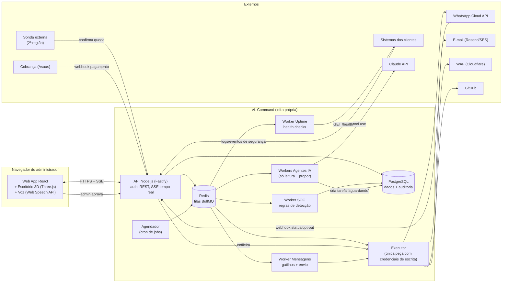

# 1. Arquitetura geral

## Princípios que guiam a arquitetura

- **Gate de aprovação é infraestrutura, não convenção.** Agentes de IA nunca têm credenciais de escrita.
  Eles só conseguem *propor* (criar uma `tarefa` com uma `acao` tipada). Quem executa é o **Executor**,
  um serviço separado que só roda ações com `status = 'aprovada'` e aprovação registrada por um admin.
- **Monitor fora do monitorado.** A VL Command roda em infraestrutura separada da dos clientes, e uma sonda
  externa (segunda região) confirma quedas antes de alertar — evita falso positivo e ponto cego.
- **Tudo auditável.** Toda ação (admin, agente, executor, webhook) grava em `log_auditoria`, que é
  append-only no banco (trigger bloqueia UPDATE/DELETE).
- **Multi-tenant por `cliente_id`.** Toda entidade de negócio pertence a um cliente. O admin vê todos;
  o portal do cliente (fase 2+) só vê o próprio, reforçado por Row-Level Security no Postgres.

## Diagrama

## Componentes

| Componente | Responsabilidade |
|---|---|
| **Web App** | SPA React. Todas as telas (ver `04-telas.md`), escritório 3D, comando de voz. Recebe eventos em tempo real por SSE. |
| **API** | Autenticação, CRUD, cálculo de métricas financeiras, endpoints de ingestão (eventos de segurança, webhooks de pagamento/WhatsApp/uptime), aprovação de tarefas. |
| **Agendador** | Dispara jobs recorrentes: health checks (60 s), avaliação de regras SOC (1 min), gatilhos de mensagem (15 min), ciclos dos agentes, geração de faturas (diário), relatórios mensais. |
| **Worker Uptime** | Executa checks HTTP/TLS, grava `check_saude`, abre/fecha `incidente` (abre após 3 falhas seguidas confirmadas pela sonda externa). |
| **Worker SOC** | Aplica regras sobre `evento_bruto`: pico de requisições, força bruta em login, varredura (muitos 404 distintos), anomalia de 4xx/5xx. Gera `evento_seguranca` com severidade e recomendação; críticos alertam na hora. |
| **Worker Mensagens** | Resolve gatilhos (por data/evento), monta lote, aplica opt-out e horário comercial, e cria tarefa de envio (disparo em massa sempre pede aprovação). |
| **Workers Agentes** | Um por papel. Loop: lê contexto (somente leitura) → chama Claude com ferramentas de leitura → produz proposta → cria `tarefa`. Teto de custo diário por agente. |
| **Executor** | Único processo com segredos de escrita (WhatsApp, Cloudflare, GitHub, e-mail). Só processa tarefas aprovadas, de um catálogo fechado de ações, de forma idempotente. Grava resultado e auditoria. |

## Segurança da própria plataforma

- **Admin único**: senha com scrypt (nativo do Node, custo alto) + **TOTP obrigatório** (segredo cifrado com AES-256-GCM); sessão em cookie `HttpOnly; Secure; SameSite=Strict`, expira em 12 h.
- **Step-up**: aprovar ações de alto impacto (disparo em massa, bloqueio de IP, pen test, abrir PR) exige o código TOTP de novo.
- **Ingestão autenticada**: cada sistema tem uma chave de ingestão própria (hash no banco) para enviar eventos; webhooks externos validados por assinatura (Meta, Asaas).
- **Segredos** em variáveis de ambiente do Executor apenas; workers de agente não os recebem.
- **Pen tester restrito**: só roda em `sistema` com `pentest_autorizado = true` **e** domínio verificado por registro DNS TXT — garante que o alvo é ativo da VL Systems. Somente checagens não destrutivas (ver `05-agentes.md`).

## Stack e justificativa

| Camada | Escolha | Por quê |
|---|---|---|
| Linguagem | **TypeScript** em todo o projeto (monorepo pnpm) | Um só idioma para front, API e workers. A API roda o `.ts` direto no Node 22 (type stripping), sem etapa de build. |
| Frontend | **React + Vite**, TanStack Query, CSS simples | Pedido no escopo; Vite é o padrão atual. Um único arquivo CSS basta para o tamanho do painel. |
| 3D | **Three.js via react-three-fiber + drei** | Three.js pedido no escopo; R3F integra a cena ao estado React (estado real dos agentes). |
| Gráficos | Recharts | MRR, churn, receita × meta. |
| Voz | **Web Speech API** (pt-BR) | Nativa do navegador, sem custo; texto como alternativa já previsto no escopo. |
| API | **Node.js + Fastify** | Leve, rápido, validação de schema embutida. |
| Banco | **PostgreSQL 16** | Relacional pedido; RLS para multi-tenant; JSONB para payloads de ações/eventos. |
| Acesso ao banco | SQL puro com `pg` + migrações `.sql` numeradas | Schema em SQL é a fonte da verdade; sem ORM para aprender ou depurar. |
| Filas / jobs | Fase 1: processo `worker` com intervalos e lock no Postgres (uma instância ativa). Fase 2/3: **Redis + BullMQ** | Na Fase 1 os jobs são poucos e periódicos; a fila com retry/concorrência entra junto com Executor e agentes. |
| IA | **Claude API** (tool use) | Ferramentas tipadas por agente; modelos por papel (ver `05-agentes.md`). |
| Mensagens | **WhatsApp Cloud API** (Meta) + e-mail via Resend ou SES | API oficial; templates aprovados obrigatórios fora da janela de 24 h. |
| Cobrança | **Asaas** | Pix, boleto e cartão no Brasil, com webhooks de pagamento. |
| WAF | **Cloudflare API** | Bloqueio de IP/regras por zona, acionado só pelo Executor. |
| Infra | Docker Compose em VPS (app, worker, postgres, caddy com HTTPS automático, backup) — Redis e executor entram na Fase 2/3 | Simples de operar para uma empresa pequena; escala para orquestrador depois se necessário. |
| Observabilidade | Logs JSON (pino) + Sentry | Erros da própria plataforma. |
