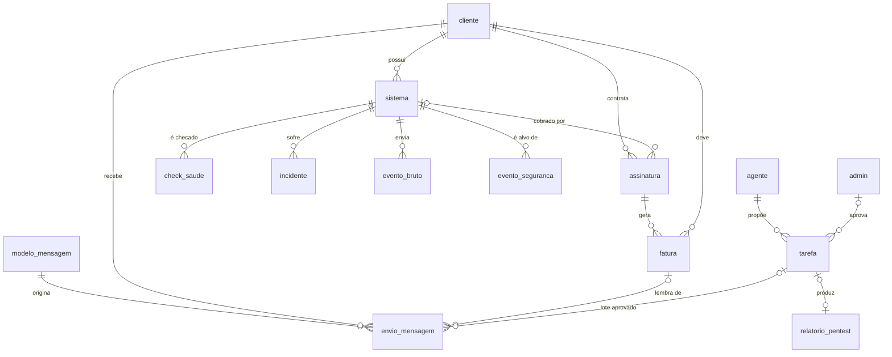

# 3. Modelo de dados

Fonte da verdade: [`db/schema.sql`](../db/schema.sql) (PostgreSQL 16). Autoteste: [`db/tests/schema_test.sql`](../db/tests/schema_test.sql).

```bash
createdb vlc && psql -v ON_ERROR_STOP=1 -d vlc -f db/schema.sql -f db/tests/schema_test.sql
```

## Diagrama entidade-relacionamento



## Entidades

| Entidade (escopo) | Tabela | Observações |
|---|---|---|
| Cliente | `cliente` | Contato, canal preferido, opt-out por canal. |
| Sistema | `sistema` | URL, hospedagem, domínio/SSL com vencimento, status de saúde, chave de ingestão, autorização de pen test + verificação de domínio, zona WAF. **Acessos**: só referência ao cofre de senhas, nunca a senha. |
| Contrato / Assinatura | `assinatura` | Valor de projeto (único) e valor mensal (recorrente), ciclo de cobrança, início, renovação, cancelamento. |
| Fatura | `fatura` | Tipo projeto/recorrente, competência, vencimento, status, `gateway_id` para idempotência do webhook. Única por assinatura+competência. |
| — | `meta_receita` | Meta mensal para "receita × meta". |
| CheckSaude | `check_saude` | Um registro por checagem; origem principal/sonda externa/webhook. Retenção 90 dias. |
| — | `incidente` | Queda/degradação/SSL/domínio com início e fim; no máximo um aberto por sistema e tipo. |
| — | `evento_bruto` | Logs recebidos dos sistemas para as regras do SOC. Retenção 30 dias. |
| EventoSeguranca | `evento_seguranca` | Tipo, severidade, IP, recomendação, evidências, status. |
| Agente | `agente` | Nome (usado na voz), função, modelo, estado, teto de custo. |
| Tarefa | `tarefa` | Proposta: descrição, ação tipada + payload, impacto, status de aprovação, resultado, custo. **CHECK no banco impede status aprovada/executada sem `aprovada_por`.** |
| — | `relatorio_pentest` | Achados com severidade e correção. |
| ModeloMensagem | `modelo_mensagem` | Corpo com variáveis, template WhatsApp e status de aprovação na Meta, gatilho, recorrência, horário comercial. |
| EnvioMensagem | `envio_mensagem` | Conteúdo final, status (enviada/entregue/lida/falhou) via webhook; único por modelo+cliente+fatura (não duplica lembrete). |
| — | `notificacao` | Alertas para o admin. |
| LogAuditoria | `log_auditoria` | Autor (admin/agente/executor/sistema/webhook), ação, entidade, contexto. **Imutável por trigger.** |

## Regras de cálculo (visões e API)

- **MRR** = soma de `valor_mensal_cent` das assinaturas ativas (`v_mrr`); **ARR** = MRR × 12.
- **Receita do período** = faturas pagas no período, separadas por tipo (`v_receita_mensal`).
- **Ticket médio** = receita recorrente do mês ÷ clientes com assinatura ativa.
- **Tempo de permanência** = média de (`cancelado_em` ou hoje) − `inicio_em` por cliente.
- **Churn de receita (mês)** = MRR cancelado no mês ÷ MRR no início do mês.
- **Inadimplência** = valor vencido e não pago ÷ valor faturado vencido no período (`v_inadimplencia` dá o detalhe).
- **Previsão** = projeção dos próximos 12 meses das assinaturas ativas, respeitando `renovacao_em`.
- Valores sempre em **centavos (bigint)**.
