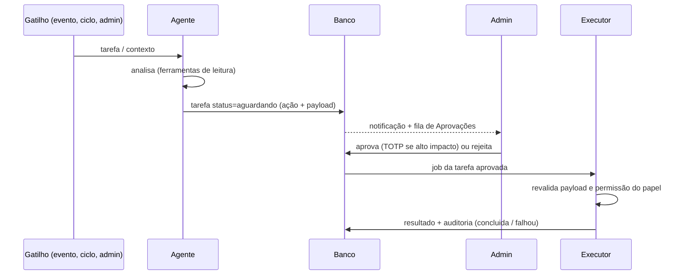

# 5. Especificação dos agentes

## Regras comuns a todos

1. **Sem credenciais de escrita.** O agente só tem ferramentas de *leitura* e a ferramenta `propor_acao`.
2. **Catálogo fechado de ações.** `propor_acao` aceita apenas os tipos permitidos ao papel (tabela abaixo). Payload validado por schema no momento da proposta e de novo no Executor.
3. **Confirmação obrigatória.** A tarefa nasce `aguardando`. Só o admin muda para `aprovada` (TOTP extra se `impacto = alto`). O banco recusa tarefa executada sem `aprovada_por`. Tarefas não decididas expiram em 72 h.
4. **Registro.** Cada passo (proposta, decisão, execução, resultado, custo de IA) vai para `tarefa` e `log_auditoria`.
5. **"24/7" = por evento + ciclos agendados**, não loop contínuo. Cada agente tem teto de custo diário; ao atingir, fica `ocioso` e avisa o Diretor.
6. **Estado** (`trabalhando` / `aguardando` / `ocioso`) é atualizado pelo worker e alimenta o Escritório 3D.
7. **Conteúdo externo é dado, não instrução.** Logs, páginas de sites e mensagens de clientes entram no prompt marcados como não confiáveis; um agente nunca muda de comportamento por texto encontrado neles.

## Fluxo

## A equipe

| Nome | Função | Modelo | Quando roda | Ferramentas de leitura | Ações que pode propor | Limites |
|---|---|---|---|---|---|---|
| **Helena** | Diretor (orquestrador) | `claude-sonnet-5-5` | Ciclo diário 08:00 + sob comando | Métricas financeiras, saúde, eventos de segurança, tarefas de todos os agentes | `delegar_tarefa` (cria tarefa para outro agente — não precisa aprovação, pois não tem efeito externo), `enviar_resumo_admin` | Não executa nada no mundo real além de resumos para o próprio admin. |
| **Marcos** | Marketing | `claude-sonnet-5-5` | Semanal + sob comando | Analytics dos sites (se integrado), histórico de mensagens, financeiro por cliente | `enviar_mensagens` (lote para clientes, via modelos aprovados), `criar_modelo_mensagem` | Respeita opt-out e horário comercial; lote sempre mostra destinatários antes da aprovação. |
| **Lara** | Designer | `claude-sonnet-5-5` | Mensal por sistema + sob comando | Captura de tela e HTML público dos sistemas, notas de UX | `abrir_pr` (mudanças de UI/CSS) | Só propõe; PR aberto em branch, merge sempre humano no GitHub. |
| **Rafael** | Engenheiro de software | `claude-opus-5-5` | Diário por sistema + ao surgir incidente + sob comando | Repositórios (somente leitura), incidentes, erros (Sentry), latência | `abrir_pr` (correção de bug/performance, com diff e testes) | Nunca faz merge ou deploy; diff completo exibido na aprovação. |
| **Vigia** | SOC Nível 1 | `claude-haiku-5-5` | A cada novo `evento_seguranca` média+ | Eventos brutos e de segurança, histórico do IP, status do sistema | `bloquear_ip` (WAF, expira em 24 h por padrão), `escalar_admin` | Só defensivo; só sistemas da VL Systems; nunca bloqueia faixas amplas (/16 ou maior). |
| **Sentinela** | Pen Tester (sob demanda) | `claude-sonnet-5-5` | **Somente quando o admin aciona** | Resultado das checagens abaixo | `gerar_relatorio_pentest` | Só em sistema com `pentest_autorizado` **e** domínio verificado por DNS TXT; checagens não destrutivas; limite de taxa; janela de execução combinada. |

### Checagens do Pen Tester (não destrutivas, ativos próprios)
- Cabeçalhos de segurança (CSP, HSTS, X-Frame-Options etc.) e configuração TLS.
- Arquivos/caminhos sensíveis expostos (`.env`, `.git/`, backups, painéis admin abertos).
- Dependências com CVEs conhecidas (a partir do repositório).
- Varredura de baseline OWASP ZAP (modo passivo) no próprio domínio.
- Política de senha e limitação de tentativas de login (verificação de configuração, sem ataque de força bruta).

Resultado: `relatorio_pentest` com achados, severidade, evidência e correção sugerida; achados viram `evento_seguranca` tipo `pentest_achado` e podem gerar tarefa para o Engenheiro.

## Comando de voz / texto
1. Admin segura o botão e fala: *"Rafael, verifica por que o site da Padaria X está lento."*
2. Transcrição (Web Speech API, pt-BR). O primeiro nome reconhecido de agente define o destinatário; se nenhum, vai para Helena.
3. Cria tarefa `origem = admin_voz`; agente analisa e devolve uma **proposta** (falada por síntese de voz + exibida).
4. Admin confirma por voz ("confirmo") **e** clique/TOTP conforme o impacto. Sem confirmação explícita, nada é executado.
